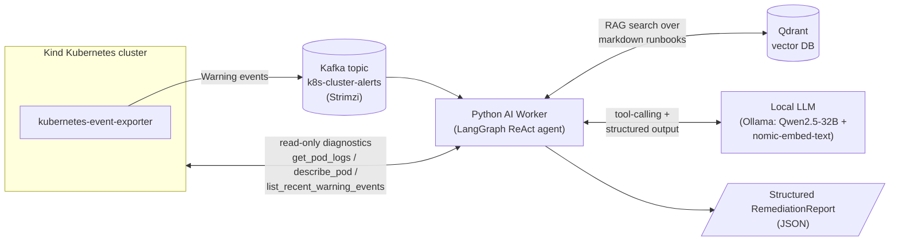

# AI-Powered Kubernetes Log & Event Remediation Controller

A personal learning project (not affiliated with any employer): an event-driven AIOps pipeline
that watches a live Kubernetes cluster for `Warning` events (`CrashLoopBackOff`,
`ImagePullBackOff`, `OOMKilled`, `FailedScheduling`, failing probes, ...), streams them through
Kafka, and hands each one to a local, open-source LLM agent that investigates root cause -- using
RAG over hand-written runbooks plus read-only Kubernetes diagnostic tools -- and produces a
structured remediation report. Everything runs on a single Mac: no cloud LLM API, no data leaves
the machine.

Full original spec: [`project.md`](./project.md).

## Architecture



## Status

| Phase | Description | Status |
|---|---|---|
| 1 | Local AI infra: Ollama (LLM + embeddings) and Qdrant on a Kind cluster | Done |
| 2 | Event pipeline: kubernetes-event-exporter -> Strimzi Kafka topic `k8s-cluster-alerts` | Done |
| 3 | LangChain/LangGraph AI worker: RAG + tool-calling agent -> structured report | Done |
| 4 | GitOps closed loop: agent commits a fix, Argo CD syncs it to the cluster | Not started |

**Phase 4 is intentionally not built yet**, and Phase 3's toolset is intentionally read-only --
there is no `apply_yaml` tool, even though `project.md` lists one as an example. The agent's job
currently ends at *diagnosis and a proposed fix*; it never calls `kubectl apply` itself. That
boundary is deliberate (see `ai-worker/README.md`), so there's no mutating capability to retrofit
safety around later -- Phase 4 will add an explicit, auditable "propose a git commit" step instead.

## Tech stack

- **Kubernetes**: Kind (local cluster), `kubernetes-event-exporter`
- **Streaming**: Apache Kafka via the Strimzi operator (KRaft mode, single broker)
- **Vector DB**: Qdrant
- **LLM runtime**: Ollama, running `qwen2.5:32b-instruct-q4_K_M` (chat/tool-calling) and
  `nomic-embed-text` (embeddings) fully locally
- **AI worker**: Python, LangChain + LangGraph (`create_react_agent`), `langchain-qdrant`,
  `confluent-kafka`, the official `kubernetes` Python client, Pydantic

## Repo layout

```
project.md                    -- original project spec
cluster.yaml                  -- Kind cluster config
qdrant-values.yaml             -- Qdrant Helm values
kafka-cluster.yaml             -- Strimzi KafkaNodePool / Kafka / KafkaTopic CRs
event-exporter-values.yaml     -- kubernetes-event-exporter Helm values
ai-worker/                     -- Phase 3: the LangChain AI worker (see its own README)
  agent.py                     -- two-stage LangGraph ReAct agent + structured-output finalizer
  k8s_tools.py                 -- read-only Kubernetes diagnostic tools
  rag.py / ingest_playbooks.py -- Qdrant-backed RAG over playbooks/*.md
  main.py                      -- Kafka consumer entrypoint
  playbooks/                   -- hand-authored runbooks (the RAG corpus)
```

## Example output

A real run against a pod requesting a non-existent image tag
(`ai-worker/output/default_bad-image-e2e4-1790429740_Failed_20260926T133754Z.json`, committed as a
sample -- everything else in `ai-worker/output/` is gitignored runtime state):

```json
{
  "report": {
    "root_cause": "The specified image tag `nginx:this-tag-still-does-not-exist` does not exist in the Docker registry.",
    "evidence": "The container state is `Waiting` with `reason=ImagePullBackOff`. The error message in the event indicates `failed to resolve reference \"docker.io/library/nginx:this-tag-still-does-not-exist\"...`.",
    "remediation_summary": "Correct the `image:` field in the pod's YAML manifest to use a valid image tag, such as `nginx:1.27`.",
    "confidence": "high",
    "requires_human_review": false
  },
  "tools_used": ["search_playbooks", "describe_pod"]
}
```
`tools_used` is computed from the agent's actual tool-call log (not self-reported by the LLM), so
it's an honest record of whether the agent really did RAG + live-cluster inspection before
answering, rather than pattern-matching the error text alone.

## Running it

See [`ai-worker/README.md`](./ai-worker/README.md) for full setup and run instructions.

## What this project is about

Per `project.md`'s own framing, the point of building this by hand rather than wiring up a
managed AIOps SaaS product was to get hands-on with:
- **LLM sizing/quantization**: running a 32B-parameter model locally on consumer hardware and
  feeling out the real latency/quality tradeoff (a full investigate-and-report cycle takes a
  few minutes on this hardware -- a real constraint, not a bug).
- **Structured output + tool calling with a local model**: local models are noticeably less
  reliable than frontier hosted APIs at emitting strict schemas *while* also reasoning through a
  tool-calling loop, which is why the agent here is deliberately split into a free-form
  investigation stage and a separate, tools-free structuring stage.
- **Event-driven AIOps architecture**: Kafka as the decoupling point between cluster events and
  AI processing, instead of a synchronous request/response API.
